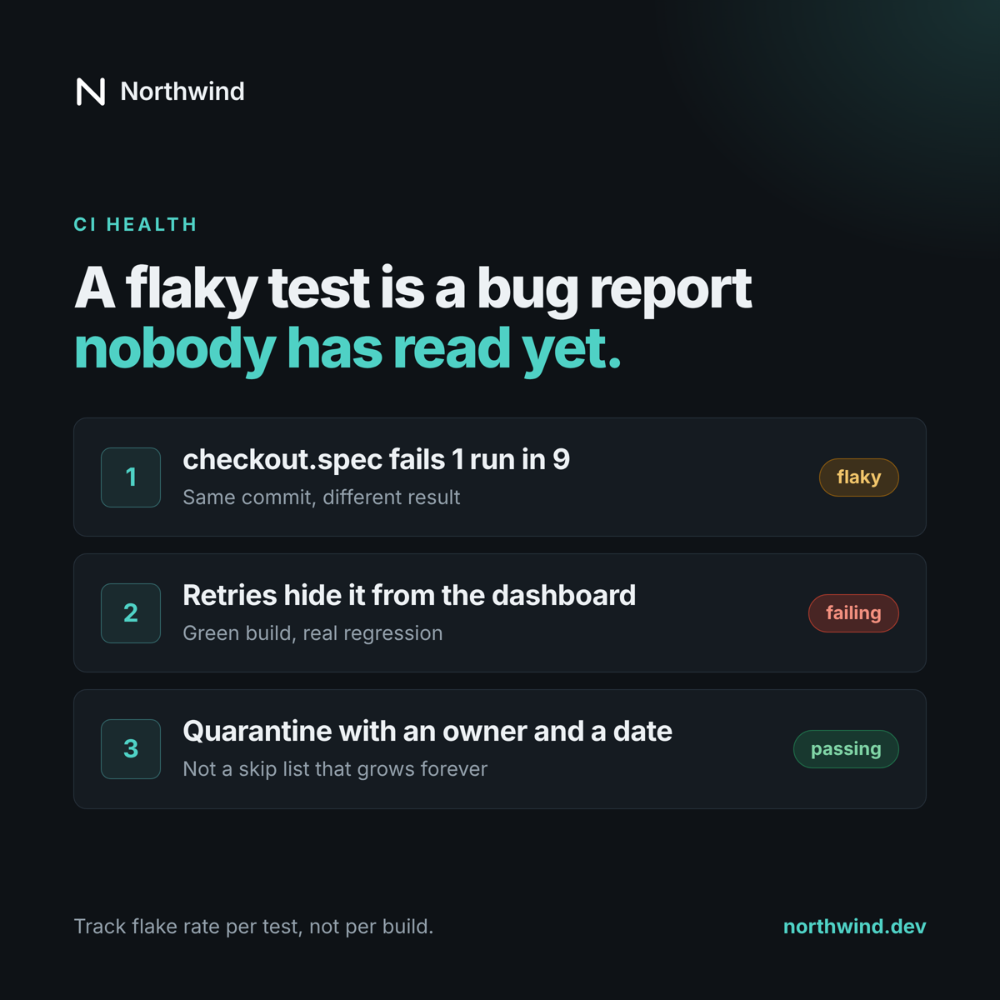
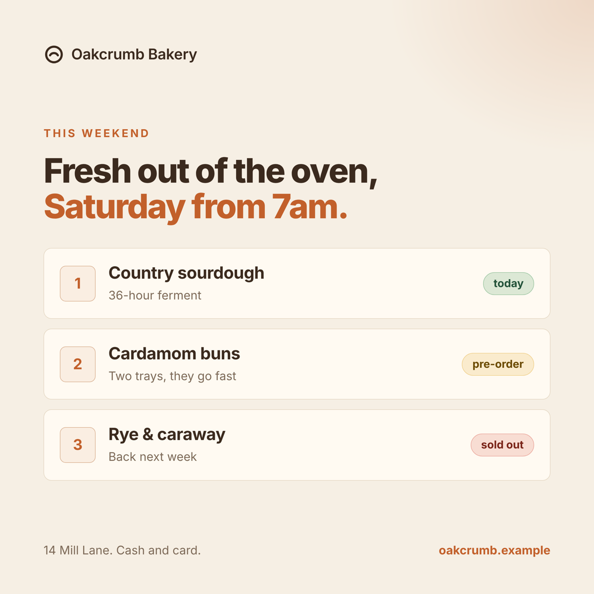

# postline

Plan, render and publish branded social posts from a git repo.

postline treats a content calendar like code. Each post is a Markdown file with a
small block of front matter. postline checks it against your house rules, renders
an on-brand image card for it, and publishes it to LinkedIn, Bluesky, Mastodon or
any webhook when its time comes. A scheduled GitHub Actions job does the sending,
and a ledger committed back to the repo records what went where.

<p>
  
  
</p>


Same template, two brands. Every pixel comes from `postline.config.yaml` and the post file.

## Why

Most small teams post from someone's head and a scheduler tab. That works until
you want consistent visuals, a second person reviewing copy, a record of what went
out, or the same posts on three networks. postline gives you:

- **Posts as files.** Review copy in pull requests. Grep your history. Nothing locked in a vendor.
- **Cards from config.** Colours, font and logo live in one file. No design tool round trips for a weekly post.
- **Rules that block bad posts.** Hashtag limits, banned phrases, allowed link domains, emoji policy, character limits per network, and a check for broken text encoding.
- **Boring, safe publishing.** Official APIs only. A post is sent at most once; if a run dies mid-send, postline stops and asks instead of guessing.

## Quick start

```sh
npx postline init my-content
cd my-content
npx playwright-core install chromium   # once, for rendering cards
npx postline plan                      # draft files for next week's empty slots
npx postline render                    # cards land in out/cards/
npx postline lint
npx postline publish --dry-run
```

Then push the repo to GitHub, add your tokens as Actions secrets, and the bundled
workflow publishes every 15 minutes.

## A post

```markdown
---
at: 2026-10-27 09:00
channels: [linkedin, bluesky]
topic: flaky-tests
card:
  layout: rows
  eyebrow: CI health
  headline:
    - A flaky test is a bug report
    - nobody has read yet.
  items:
    - title: checkout.spec fails 1 run in 9
      note: Same commit, different result
      chip: flaky
    - title: Quarantine with an owner and a date
      chip: passing
  footer: Track flake rate per test, not per build.
variants:
  bluesky: Shorter text for the 300 character limit.
---

A flaky test is a bug report nobody has read yet.

Most teams treat flakes as noise. Retry, get a green build, move on...

#CI #Testing
```

The body is the post. `card` describes the image. `variants` overrides the text per
channel. Full reference in [docs/guides/content-format.md](docs/guides/content-format.md).

## Commands

| Command | What it does |
| --- | --- |
| `postline init [dir]` | Scaffold a config, a sample post, a logo and the GitHub workflow |
| `postline plan [--week DATE]` | Create draft files for every empty slot in a week |
| `postline status [--week DATE]` | Show each slot and whether it is empty, drafted, queued or sent |
| `postline brief [--week DATE]` | Print a Markdown writing brief: open slots, rules, recent topics |
| `postline lint` | Check every post; exits non-zero on errors |
| `postline render [id] [--force] [--html]` | Render cards to `out/cards/` |
| `postline publish [--dry-run] [--now ISO] [--catch-up] [--only ID]` | Send everything that is due |
| `postline retry <id> <channel>` | Clear a failed or stuck entry so it sends again |
| `postline mark <id> <channel> <published\|skipped>` | Record an outcome by hand |

## Channels

| Type | Notes |
| --- | --- |
| `linkedin` | Company pages or members, via the Posts API. Hashtags stay clickable. |
| `bluesky` | App password login. Links and hashtags become rich-text facets. |
| `mastodon` | Any instance. Uses an idempotency key so retries don't double post. |
| `webhook` | Signed JSON POST. Use it for Zapier, Make, n8n, Slack approvals or your own service. |
| `files` | Writes Markdown + image into a folder, e.g. your static site's blog or an archive. |

Setup for each, including tokens: [docs/guides/channels.md](docs/guides/channels.md).

## Documentation

- [Getting started](docs/guides/getting-started.md)
- [Configuration](docs/guides/configuration.md)
- [Content format](docs/guides/content-format.md)
- [Channels](docs/guides/channels.md)
- [Scheduling with GitHub Actions](docs/guides/scheduling.md)
- [Architecture decisions](docs/architecture/README.md)

## Examples

- [`examples/northwind`](examples/northwind): a developer-tools company, dark theme, three posts a day, LinkedIn + Bluesky + archive.
- [`examples/oakcrumb`](examples/oakcrumb): a bakery, light theme, four mornings a week, Mastodon + Instagram through Zapier.

## Development

```sh
npm install
npm test
node dist/src/cli.js render --cwd examples/northwind
```

Set `POSTLINE_CHROMIUM` to use a Chromium you already have.

## License

MIT
